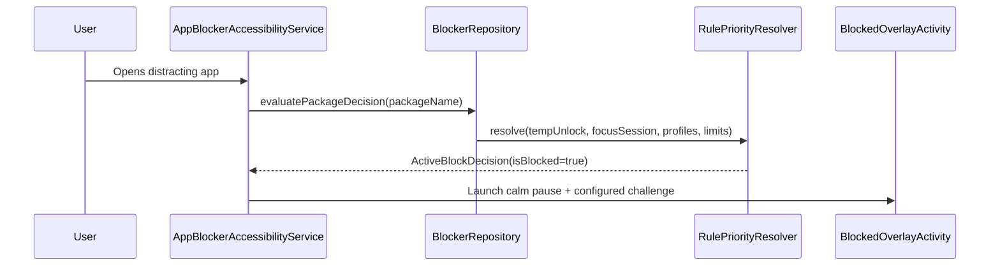

# Architecture

FocusNest follows **Clean Architecture + MVVM** with unidirectional data flow:

- `domain.model`: Pure Kotlin business logic (`RulePriorityResolver`, `UnlockChallengeEngine`, `FocusTimeUtils`, domain enums). Zero Android framework imports so domain logic runs in fast JVM unit tests.
- `core.database`: Room SQLite database (`FocusNestDatabase`, version 2) with 21 entities (`HabitEntity`, `HabitCompletionEntity`, `CategoryLimitEntity` included), indexed DAOs returning `Flow<T>`, JSON `TypeConverters`, and non-destructive `MIGRATION_1_2`.
- `core.datastore`: `FocusNestPreferences` managing theme, 6 accent palettes, English/Hindi language selection, per-app VPN network scope, Pomodoro config, Invincible Mode state, Mindful settings, and reboot-persistent epoch + `elapsedRealtime()` timer state (`targetEndEpochMs`, `startedAtEpochMs`, `targetEndElapsedRealtimeMs`).
- `core.common`: Portable AES-256-GCM (`PBKDF2WithHmacSHA256`) backup crypto, Android Keystore helper, ZXing offline QR generator, SHA-256 token verification, and OEM compatibility guidance.
- `core.permissions`: `PermissionManager` inspecting `AppOpsManager`, `Settings.Secure`, `VpnService.prepare`, `NfcAdapter`, and `PowerManager`.
- `data.repository`: `UsageStatsRepository`, `BlockerRepository`, `FocusRepository`, `HabitRepository`, and `InsightsAndBackupRepository`.
- `service` & `widget`: `FocusTimerService`, `AppBlockerAccessibilityService`, `FocusNestVpnService`, `FocusNotificationService`, `FocusQuickTileService`, `FocusUsageMonitorWorker`, `BootCompletedReceiver`, and 3 `AppWidgetProvider` classes.
- `feature.*` & `ui`: Jetpack Compose Material 3 screens (`home`, `focus`, `blocker`, `insights`, `habits`, `more`, `challenges`, `onboarding`) driven by `FocusNestViewModel` and `collectAsStateWithLifecycle()`.

