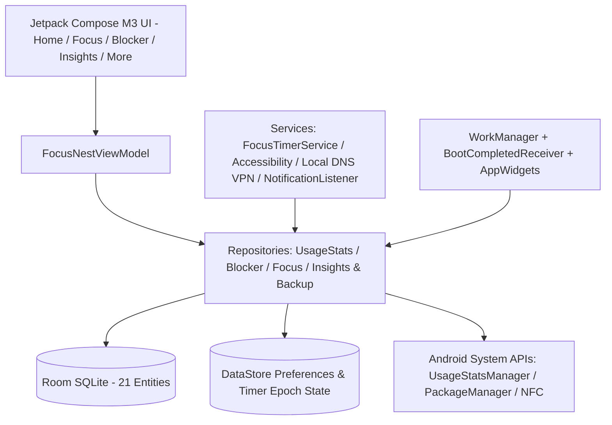

# FocusNest

**Own Your Time. Protect Your Focus.**

FocusNest is a 100% free, privacy-first, open-source Android digital wellbeing, focus timer, screen-time analytics, and app-blocking application built with Kotlin, Jetpack Compose, Material 3, Room, DataStore, and WorkManager.

## Core Principles

- **100% Free & Open Source** — No paywalls, no premium tiers, no ads.
- **Offline-First & Zero Trackers** — No `INTERNET` permission, no telemetry, no mandatory accounts.
- **Transparent Permissions** — Every Android permission (`PACKAGE_USAGE_STATS`, `AccessibilityService`, `VpnService`, `NotificationListenerService`, `CAMERA`, `NFC`) is optional and requested contextually.
- **Owner-Controlled** — Clear emergency recovery, encrypted local AES-256-GCM backups, and zero stealth device locking.

## Architecture Overview



## Key Features

- **Home Dashboard**: Real screen-time goal ring, yesterday-vs-today usage comparison, remaining allowance, top apps with launcher icons & cap badges, live focus status, quick shield toggle, weekly chart, and daily intention.
- **Focus Timer & Quick Tile**: Pomodoro, Countdown, and Stopwatch modes with quick presets (`15m–90m`), live `+5m` extend, restart, break skip, Android Quick Settings Tile, reboot-persistent epoch timing, streaks, and timeline history.
- **App Blocker & Profiles**: Installed app search, categories, **Category Daily Caps**, **Grace Periods**, 80%/90%/100% usage warnings, shared app groups, daily/weekly limits, 6+ preset profiles (`Study`, `College`, `Work`, `Sleep`, `Reading`, `Weekend`, `Custom`), and deterministic rule-priority resolution.
- **12 Unlock Challenges**: Strict Mode, Fixed Cooldown, Temporary Unlock, Offline QR Scan, Offline Barcode Scan (with SHA-256 signatures, single-use, and expiry support), NFC Tag Tap, Adaptive Math, Sentence Typing, Personal Intention, Daily Unlock Cap, Reflection Pause, and Guided Breathing (4-2-4).
- **Offline Habits & Routines**: Daily/weekly habit tracking, streaks, multi-unit counters, and 7-day completion rate charts stored locally.
- **Local Website Filter & Per-App Network Scope**: Optional on-device `VpnService` DNS sinkhole (blocklist, allowlist, offline packs) and per-app VPN network restriction with zero external servers.
- **Reels & Shorts Reduction**: Configurable pause prompts and daily limits for Instagram Reels, YouTube Shorts, Facebook Reels, and TikTok.
- **Insights, Localization & Exports**: Daily/weekly/monthly/custom-range analytics, English & Hindi localization, 6 accent palettes, granular privacy cleanup, CSV, JSON, and printable HTML reports.
- **Widgets & Hardware**: 3 Home Screen widgets, CameraX + ZXing offline QR/Barcode scanner & generator, native Android NFC tag vault, and BiometricPrompt support for Invincible Mode.

## Building & Testing

```bash
gradle :app:assembleDebug
gradle :app:testDebugUnitTest
```

See [BUILD.md](BUILD.md), [TESTING.md](TESTING.md), and [docs/getting-started.md](docs/getting-started.md) for full details.
